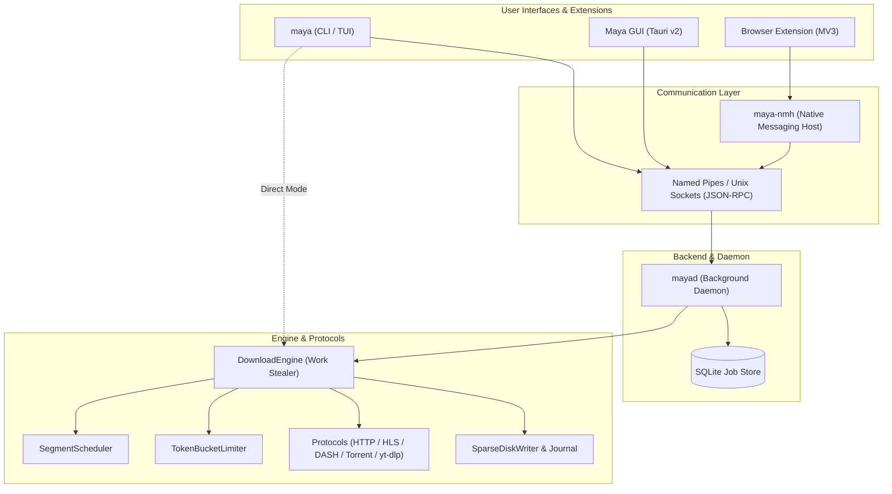

<div align="center">

# ⚡ Maya Downloader

**Fast, resilient, multi-protocol CLI, TUI & GUI download manager written in Rust.**

[](https://github.com/uixatik/maya/releases)
[](LICENSE)
[](https://github.com/uixatik/maya/actions/workflows/ci.yml)
[](https://www.rust-lang.org)
[](#installation)

[Downloads](https://github.com/uixatik/maya/releases/latest) • [Installation](#installation) • [Architecture](#architecture) • [CLI & TUI](#cli--tui-usage) • [Desktop GUI](#desktop-gui) • [Contributing](CONTRIBUTING.md) • [Security](SECURITY.md)

</div>

---

## Overview

**Maya** is a modern, high-throughput, memory-safe download accelerator designed to replace legacy tools like Internet Download Manager (IDM) and `aria2`. Built entirely in Rust with an asynchronous Tokio runtime, Maya provides multi-connection segmented downloads, adaptive in-half work stealing, crash-safe state journaling, streaming video stream extraction, and browser capture extensions.

### Feature Comparison

| Feature | Maya | aria2 | IDM | curl / wget |
| :--- | :---: | :---: | :---: | :---: |
| **Language & Safety** | **Rust (Memory-Safe)** | C++ | C++ | C |
| **Segmented Range Downloads** | :white_check_mark: | :white_check_mark: | :white_check_mark: | :x: |
| **Adaptive Work Stealing** | :white_check_mark: | :x: | :white_check_mark: | :x: |
| **Zero-Merge Sparse Storage** | :white_check_mark: | :white_check_mark: | :x: *(Reassembles on finish)* | :x: |
| **Interactive Terminal TUI** | :white_check_mark: *(Ratatui)* | :x: | :x: | :x: |
| **Native Desktop GUI** | :white_check_mark: *(Tauri v2)* | :x: *(Third-party web UI)* | :white_check_mark: *(Legacy Win32)* | :x: |
| **Browser Extension (MV3)** | :white_check_mark: *(Chrome/Edge/Firefox)* | :x: | :white_check_mark: | :x: |
| **BitTorrent & Magnets** | :white_check_mark: *(Pure-Rust engine)* | :white_check_mark: | :x: | :x: |
| **Streaming HLS / DASH / yt-dlp**| :white_check_mark: | :x: | :x: | :x: |
| **SSRF Defense & IP Pinning** | :white_check_mark: *(RFC 1918 / Loopback blocks)* | :x: | :x: | :x: |
| **Background Daemon & Queue** | :white_check_mark: *(`mayad` SQLite)* | :white_check_mark: *(XML-RPC)* | :white_check_mark: | :x: |
| **Open Source License** | **MIT License** | GPLv2 | Proprietary / Paid | MIT / GPL |

---

## Highlights & Capabilities

- **Segmented High-Speed HTTP/HTTPS**: Multi-connection byte-range transfers with IDM-style in-half work stealing (`SegmentScheduler`) and `HEAD` → `GET Range: bytes=0-0` probe fallback.
- **Media & Streaming Video Downloader**: Automatic media URL detection (YouTube, Vimeo, TikTok, Bilibili, SoundCloud, generic HLS/DASH). Discovers `yt-dlp` to extract direct streams, downloads separate high-definition video and audio tracks concurrently via `DownloadEngine`, and automatically muxes with `ffmpeg` (`-c copy`) with seamless temp cleanup.
- **HLS & DASH Manifest Support**: Custom pure-Rust parser for HLS (`.m3u8` master and media playlists, AES-128-CBC sliding-window segment decryption) and MPEG-DASH (`.mpd` SegmentTemplate and SegmentList).
- **Metalink & Multi-Mirror Failover**: Full support for Metalink XML (`.meta4` RFC 5854 and `.metalink` v3). Parallel mirror probing, latency and priority scoring, cross-mirror ETag/Content-Length consensus, and automatic failover on HTTP 429/503.
- **Zero-Merge Resumable Storage**: Positional concurrent zero-merge writes (`seek_write` on Windows, `write_at` on Unix) directly into `<target>.maya.part`, atomic `<target>.maya.state` checkpointing, and ETag/`Last-Modified` validation on resume.
- **BitTorrent & Magnet Transfers**: Built-in torrent/magnet engine via `librqbit` (`rust-tls`), with seeding cleanly terminated upon completion unless `--seed` is requested.
- **Batch Downloading**: `maya batch <FILE>` parses URL lists, ignores comments (`#`) and empty lines, and downloads with configurable concurrency (`-j`/`--concurrency`).
- **Interactive TUI**: `maya tui` launches a terminal interface built with `ratatui` and `crossterm`. Features a real-time aggregate speed sparkline, active download table, and hotkeys (`[p] Pause`, `[r] Resume`, `[c] Cancel`, `[a] Add URL dialog`, `[q] Quit`).
- **Background Daemon & Persistent Queue**: Dedicated `mayad` daemon binary with SQLite persistent queue storage (`~/.maya/queue.db`), Windows Named Pipe / Unix Domain Socket IPC, and CLI management via `maya daemon` and `maya queue`.
- **Browser Extension & Native Messaging**: `maya-nmh` binary implementing Chrome/Firefox standard native messaging (length-prefixed JSON stdio protocol). Automatically generates and installs manifests for seamless 1-click browser download interception.
- **Bandwidth Throttling**: Token-bucket async rate limiting (`--limit 500K`, `1.5M`, `5M`, `1G`, or raw bytes/sec).
- **Cryptographic Verification**: Streaming verification supporting SHA-256, BLAKE3, MD5, and SHA-512 (`--verify <algo>:<hex>`) with constant-time equality checks before finalization.
- **Graceful Cancellation**: `Ctrl+C` cleanly cancels active transfers and persists checkpoints (exit code `130`).

---

## Architecture

Maya is organized as a Cargo workspace with strict layer isolation:



| Crate | Responsibility |
| --- | --- |
| `crates/maya-core` | Core error/request/progress types, traits (`ProtocolClient`, `StorageWriter`, `StateStore`), `SecurityPolicy` (SSRF/path guards), `TokenBucketLimiter`, `SegmentScheduler`, `DownloadEngine`, and Metalink/Mirror routing. |
| `crates/maya-storage` | `SparseDiskWriter` (`StorageWriter`), atomic `StateJournal` (`.maya.state`), and streaming SHA-256, BLAKE3, MD5, and SHA-512 verification. |
| `crates/maya-protocols` | Multi-protocol clients: `HttpProtocolClient` (`reqwest` with `rustls-tls`, IP pinning), `TorrentClient` (`librqbit`), `MediaExtractor` (`yt-dlp`), and pure-Rust HLS/DASH parsers. |
| `crates/maya-ipc` | Cross-platform JSON-RPC IPC: Windows Named Pipes (`\\.\pipe\maya-daemon`) and Unix domain sockets (`~/.maya/maya.sock`). |
| `crates/maya-daemon` | `mayad` daemon service, SQLite queue manager (`~/.maya/queue.db`), and background download worker pool. |
| `crates/maya-cli` | `maya` command-line binary (`get`, `batch`, `torrent`, `tui`, `daemon`, `queue`, `doctor`, `version`). |
| `crates/maya-nmh` | Browser Native Messaging Host (`maya-nmh`) supporting Chrome, Edge, Brave, and Firefox. |
| `apps/maya-gui` | Tauri v2 desktop GUI with reactive TypeScript dashboard. |
| `extensions/browser-capture` | Manifest V3 browser extension for Chrome, Edge, and Firefox. |

---

## Installation

### 1. Standalone Windows GUI Installer
Download the latest Windows Installer from [GitHub Releases](https://github.com/uixatik/maya/releases/latest):
- **[Maya_0.0.1_x64-setup.exe](https://github.com/uixatik/maya/releases/download/v0.0.1/Maya_0.0.1_x64-setup.exe)** (~1.92 MiB, Per-user install into `%LOCALAPPDATA%`, no UAC admin prompt required).

---

### 2. One-Liner Terminal Installers

#### Windows (PowerShell)
Installs `maya.exe`, `mayad.exe`, and `maya-nmh.exe` into `%LOCALAPPDATA%\Programs\Maya\bin`, adds the folder to your User `PATH`, and registers native messaging manifests for Chrome, Edge, and Firefox:

```powershell
irm https://raw.githubusercontent.com/uixatik/maya/main/install.ps1 | iex
```

#### Windows (CMD / Batch)
```cmd
curl -fsSL https://raw.githubusercontent.com/uixatik/maya/main/install.cmd -o install.cmd && install.cmd
```

#### Linux & macOS (POSIX Shell)
Installs binaries into `~/.local/bin` and registers browser native host manifests:

```sh
curl -fsSL https://raw.githubusercontent.com/uixatik/maya/main/install.sh | sh
```

---

### 3. Package Managers

#### Windows (Scoop)
```powershell
scoop bucket add maya https://github.com/uixatik/maya
scoop install maya
```

#### Windows (WinGet)
```powershell
winget install Maya.MayaDownloader
```

#### Arch Linux (AUR)
```sh
cd packaging/arch
makepkg -si
```

---

### 4. Build from Source via Cargo

```sh
git clone https://github.com/uixatik/maya.git
cd maya
cargo install --path crates/maya-cli --force
cargo install --path crates/maya-daemon --force
cargo install --path crates/maya-nmh --force
```

---

## CLI & TUI Usage

### 1. `maya get`
Download files via HTTP/HTTPS, media platforms, or torrents:

```sh
maya get <SOURCE> [OPTIONS]
```

**Common Examples:**
```sh
# High-speed segmented download with 8 connections
maya get "https://example.com/largefile.iso" -c 8 -d ./downloads

# Bandwidth-limited download
maya get "https://example.com/data.tar.gz" --limit 5M

# Streaming Video extraction (YouTube, Vimeo, etc.)
maya get "https://www.youtube.com/watch?v=dQw4w9WgXcQ" -d ./downloads

# Checksum verification (SHA-256, BLAKE3, MD5, SHA-512)
maya get "https://example.com/file.zip" --verify sha256:e3b0c44298fc1c149afbf4c8996fb92427ae41e4649b934ca495991b7852b855

# Multi-mirror failover and Metalink
maya get "https://primary.mirror.org/ubuntu.iso" --mirror "https://backup1.org/ubuntu.iso"
maya get --metalink ./release.meta4 -d ./downloads
```

### 2. Interactive Terminal Dashboard (`maya tui`)
```sh
maya tui
```
Launches the full-screen terminal dashboard with real-time transfer sparklines, active downloads list, and keyboard shortcuts (`[p] Pause`, `[r] Resume`, `[c] Cancel`, `[a] Add`, `[q] Quit`).

### 3. System Diagnostics (`maya doctor`)
```sh
maya doctor
```
Verifies file write permissions, torrent engine availability, and detects system tools (`ffmpeg`, `yt-dlp`).

---

## Browser Extension Integration

Maya includes a Manifest V3 browser extension (`extensions/browser-capture`) paired with `maya-nmh` for Chrome, Edge, Brave, and Firefox:

```sh
# Register Native Messaging Host manifests with all installed browsers
maya-nmh --install-manifest
```

1. Open `chrome://extensions` (or `edge://extensions` / `about:debugging`).
2. Enable **Developer mode**.
3. Click **Load unpacked** and select `extensions/browser-capture`.
4. Any download clicked in the browser will automatically route to Maya!

---

## Security Policy

Maya implements defensive security controls:
- **SSRF Defense**: Proactively blocks loopback, private IPv4 (RFC 1918), link-local, multicast, and IPv4-mapped IPv6 ranges.
- **Path Traversal Protection**: Sanitizes filenames against relative directory traversal tokens and reserved Windows device names (`CON`, `PRN`, `AUX`, `NUL`, etc.).
- **Zero Dynamic SSL Dependencies**: Compiles exclusively with `rustls`.

For vulnerability disclosures, see [SECURITY.md](SECURITY.md).

---

## Contributing & Development

We welcome contributions! Please review [CONTRIBUTING.md](CONTRIBUTING.md) and our [Code of Conduct](CODE_OF_CONDUCT.md).

```sh
# Formatting check
cargo fmt --all -- --check

# Clippy linter (zero warnings policy)
cargo clippy --workspace --all-targets -- -D warnings

# Run all 128 tests
cargo test --workspace
```

---

## License

Maya is licensed under the [MIT License](LICENSE).
